<div align="center">

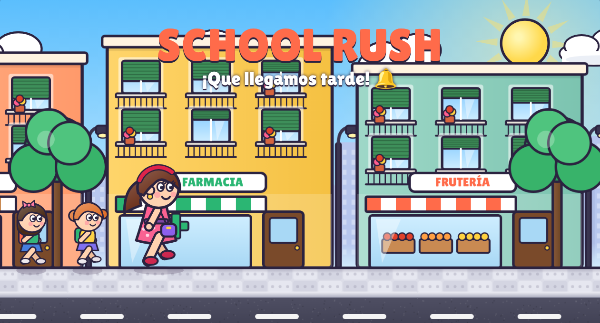

**🇪🇸 Español** · [🇬🇧 English](README.en.md)

**Una carrera de dibujos animados para llevar a los peques al cole antes de que suene la campana de las 9:00.**<br>
Hecho para jugar con mis hijas (y para reírnos de nuestras mañanas).

[](https://serbenda.github.io/school-rush/)

[](https://github.com/serbenda/school-rush/actions/workflows/pages.yml)


</div>

---

<details>
<summary><b>📑 Índice</b></summary>

- [🏃 La idea](#idea)
- [👨‍👩‍👧 Para familias](#familias)
- [🗺️ Los tramos](#tramos)
- [⏱️ Los momentos](#momentos)
- [🎮 Cómo se juega](#jugar)
- [💥 Así se siente](#sensacion)
- [👕 Los peques](#peques)
- [📱 En el móvil](#movil)
- [🔒 Privacidad](#privacidad)
- [🛠️ Bajo el capó](#tecnica)
- [🗺️ Hoja de ruta](#ruta)

</details>

<a id="idea"></a>

## 🏃 La idea

Son las **8:40**. Hay que despertar, desayunar, lavarse los dientes, vestirse… y la puerta del cole se cierra a las **9:00**. **School Rush** convierte esa carrera de cada mañana en un juego: mamá o papá corren de casa al cole con los peques detrás, por las calles de **Sanse** y **Alcobendas**, esquivando Legos, gatos, charcos, palomas… ¡y algún toro de los encierros!, mientras el reloj no perdona.

<table>
<tr>
<td width="46%" align="center" valign="top">
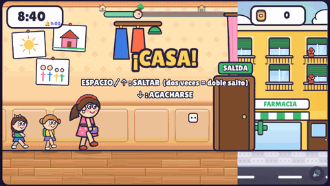<br>
<sub><b>Una partida de verdad:</b> la juega el robot de las capturas</sub>
</td>
<td width="54%" valign="top">

### En 30 segundos

- 👩‍👧‍👦 **Elige quién lleva a los niños**: mamá o papá.
- 🦘 **Salta** (doble salto en el aire) y **agáchate** para esquivar.
- 🏠➡️🎉➡️🚇➡️🏫 **Cuatro tramos seguidos**: la casa, Sanse en fiestas, Alcobendas y el cole.
- 🪥🚦🚪 **Tres momentos rápidos**: dientes, semáforo y la puerta que se cierra.
- 🍞 **Tostadas** para sumar puntos y **rachas** de hasta x5.
- 🛴☂️☕ **Power-ups**: patinete, paraguas y café.
- 👕 **Viste a los peques** con su nombre, peinado y accesorios.
- 🎁 **8 retos** que desbloquean gafas de sol, corona, capa de héroe…
- ⭐ **Llega antes de las 8:58** para las tres estrellas.

</td>
</tr>
</table>

<a id="familias"></a>

## 👨‍👩‍👧 Para familias

| | |
| --- | --- |
| 👶 **Edad** | Para todos. Los peques lo entienden en una partida gracias al tutorial, y los mayores pueden ir a por las 3 estrellas y los retos |
| ⏱️ **Duración** | Algo más de **1 minuto** por partida: perfecto para "una y nos vamos" |
| 😌 **Sin frustración** | Nadie pierde a mitad: los golpes solo suman minutos al reloj y siempre se llega al cole |
| 🚫 **Sin anuncios ni compras** | Ni cuentas, ni registros, ni nada que pagar |
| 🔇 **Silenciable** | Botón 🔇 para jugar sin sonido |
| 📱 **Dónde** | Móvil o tablet en horizontal, o en el ordenador con el teclado |

<a id="tramos"></a>

## 🗺️ Los tramos

De casa al cole pasando por **San Sebastián de los Reyes** y **Alcobendas**, dibujados con el estilo del juego.

| 🏠 La casa | 🎉 Sanse en fiestas |
| :---: | :---: |
| 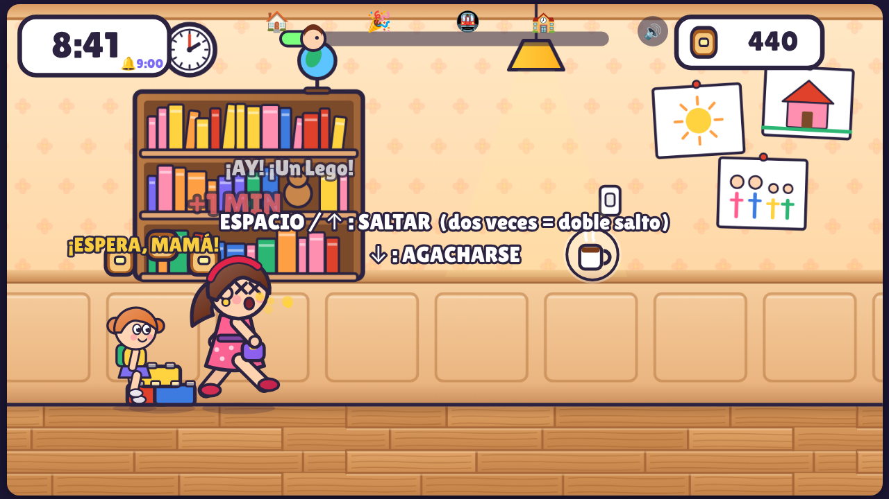 | 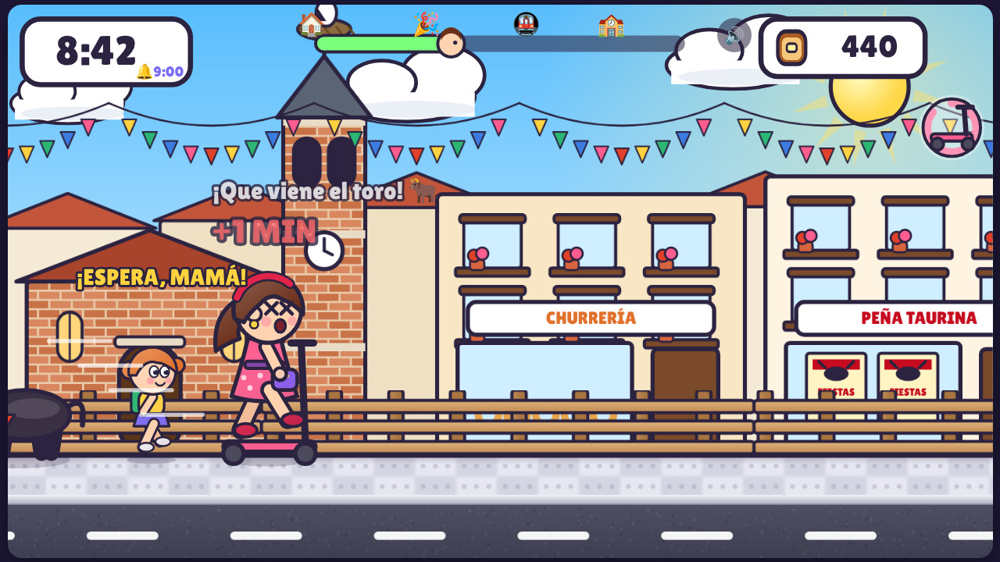 |
| Estantería con libros, dibujos en la pared y Legos por el suelo | El Ayuntamiento con sus soportales y banderas, la torre de la iglesia con su **cigüeña**, la Calle Real, la churrería, la peña taurina, banderines y **talanqueras** |
| 🚇 **Alcobendas** | 🏫 **El cole** |
| 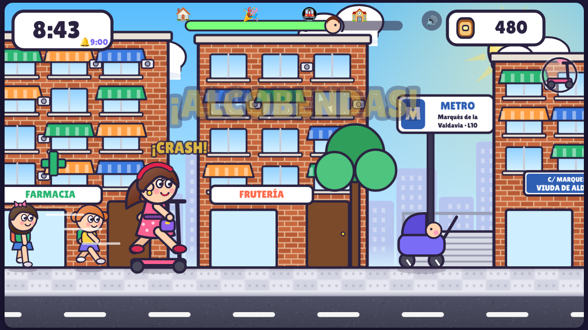 | 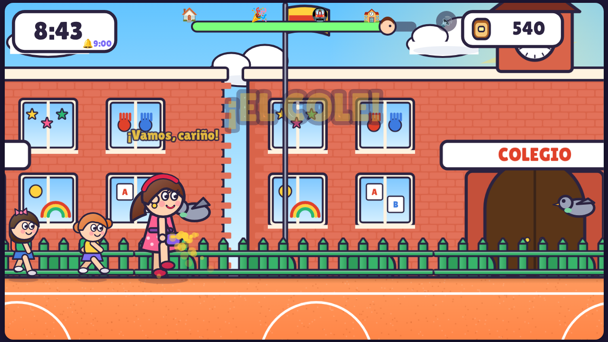 |
| Bloques de **ladrillo visto** con toldos y aparatos de aire, la calle Marquesa Viuda de Aldama, la iglesia de ladrillo y la boca de **metro de la Línea 10** | Fachada de ladrillo, torre del reloj y valla verde. El cartel lleva **el nombre de tu cole** (lo escribes en 👕 Peques) |

<p align="center">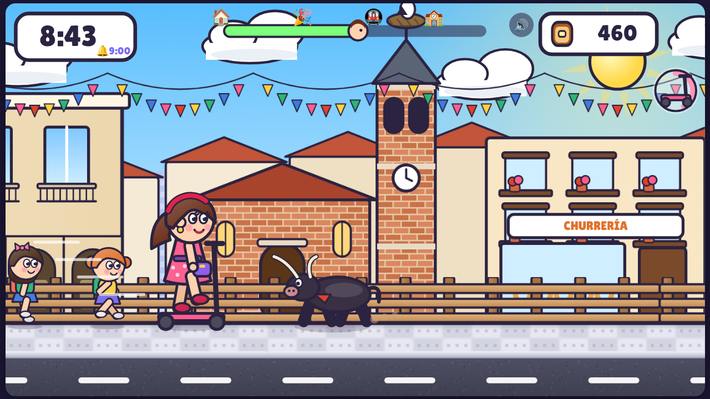<br><sub>En Sanse, cuidado: ¡se ha escapado un toro del encierro! 🐂</sub></p>

<a id="momentos"></a>

## ⏱️ Los momentos

A mitad de carrera, el juego se para un instante… pero **el reloj sigue corriendo**.

| 🪥 Dientes | 🚦 Semáforo | 🚪 La puerta del cole |
| :---: | :---: | :---: |
| 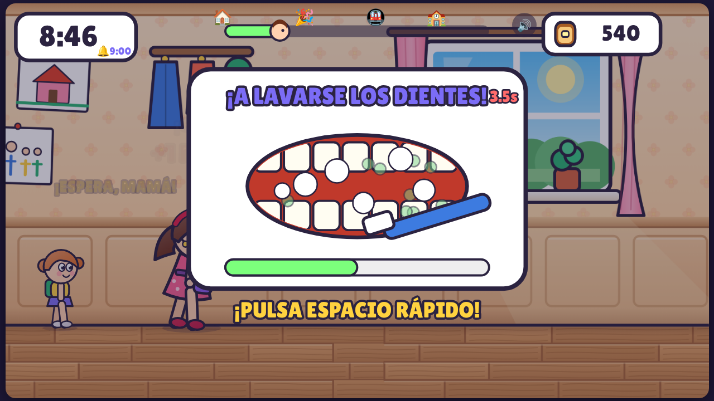 | 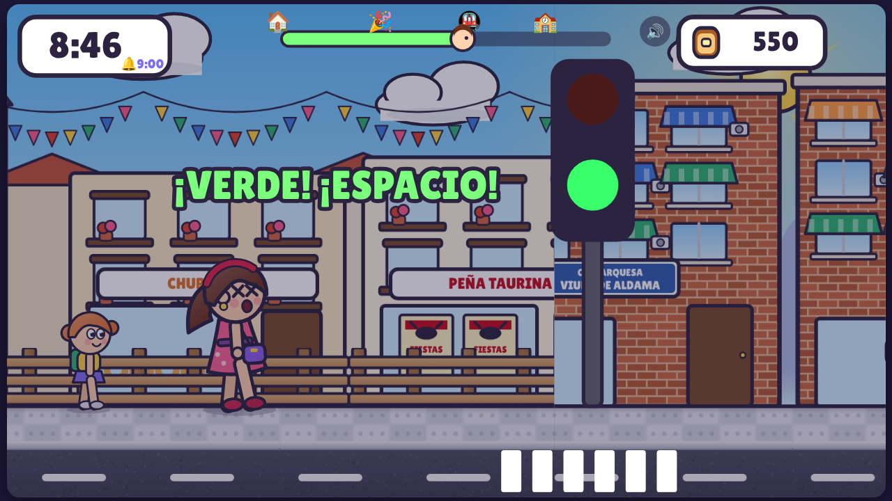 | 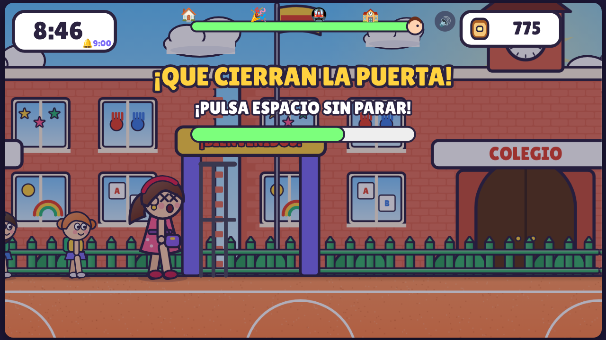 |
| **Pulsa rápido** 12 veces en 4 segundos para quitar los bichos | **Espera al verde** y pulsa con buenos reflejos | El conserje está cerrando: **pulsa sin parar** para colaros |

| Momento | Si te sale bien | Si no |
| --- | --- | --- |
| 🪥 Dientes | *¡Sonrisa brillante!* **+150 puntos** | *Dientes a medias…* **+1 min** |
| 🚦 Semáforo | Hasta **+200 puntos** según lo rápido que reacciones | Pulsar en rojo: **+1 min** (como mucho dos veces) |
| 🚪 Puerta | *¡Dentro!* **+200 puntos** | *Te toca firmar en conserjería* **+2 min** |

<a id="jugar"></a>

## 🎮 Cómo se juega

### Controles

| | 💻 Ordenador | 📱 Móvil o tablet |
| --- | --- | --- |
| **Saltar** | `Espacio` o `↑` | Botón naranja **⬆ SALTAR** (o toca la pantalla) |
| **Doble salto** | Pulsa otra vez en el aire | Pulsa ⬆ otra vez en el aire |
| **Agacharse** | Mantén `↓` | Mantén el botón morado **⬇ AGACHAR** |
| **Bajar rápido** | `↓` en el aire | ⬇ en el aire |
| **Momentos** | `Espacio` | Cualquier botón o la pantalla |

> La primera vez, un **tutorial a cámara lenta** te dice *¡SALTA!* y *¡AGÁCHATE!* justo cuando toca.

<p align="center">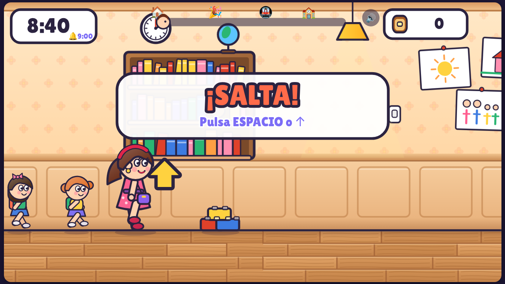</p>

### 📜 Reglas de la mañana

| Situación | Qué pasa |
| --- | --- |
| Chocas con algo | **+1 min**, frenazo, te mareas 😵 y se pierde la racha |
| Un peque tropieza | Le salen estrellitas ⭐ y **tienes que ir más despacio** hasta que te alcanza (*¡ESPERA, MAMÁ!*) |
| Esquivas un obstáculo | **+5 puntos** × racha |
| Coges una tostada 🍞 | **+10 puntos** × racha |
| Cada 8 tostadas seguidas | La racha sube: **x2, x3, x4, x5** |
| Llegas al cole | Estrellas según la hora |

### 🚧 Obstáculos

| Tramo | ⬆️ Salta | ⬇️ Agáchate |
| --- | --- | --- |
| 🏠 Casa | Legos, pelota que bota, el gato, el cesto de la ropa | Ropa tendida (¡calzoncillo en la cara!) |
| 🎉 Sanse | **El toro** 🐂, **talanqueras**, charcos, perros, carritos | Palomas |
| 🚇 Alcobendas | Charcos, perros, cubos de basura, carritos de bebé | Palomas y el andamio de las obras |
| 🏫 Cole | Balones, charcos, carritos de bebé | Palomas |

### ⚡ Power-ups

| | Dura | Qué hace |
| :---: | :---: | --- |
| 🛴 **Patinete** | 5 s | Vas un 40 % más rápido y **arrasas con todo** lo que te encuentras (+20 por obstáculo) |
| ☂️ **Paraguas** | 8 s | **Planeas** al caer: saltos larguísimos |
| ☕ **Café** | 6 s | **Turbo**: un 28 % más rápido, así llegas antes |

### ⭐ Estrellas

| Llegada | Resultado |
| --- | --- |
| **8:58 o antes** | ⭐⭐⭐ *¡Familia puntual!* |
| **8:59 – 9:00** | ⭐⭐ *¡Por los pelos!* |
| **Después de las 9:00** | ⭐ *¡Llegamos tarde!* |

Una partida dura **algo más de un minuto** y, jugando bien, se llega sobre las 8:55.

<a id="sensacion"></a>

## 💥 Así se siente

| Menú | ¡Golpe! |
| :---: | :---: |
| 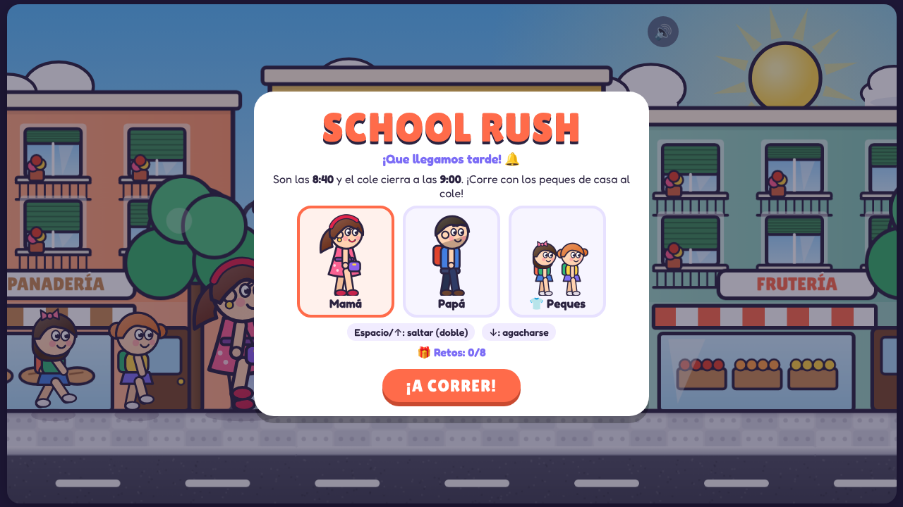 | 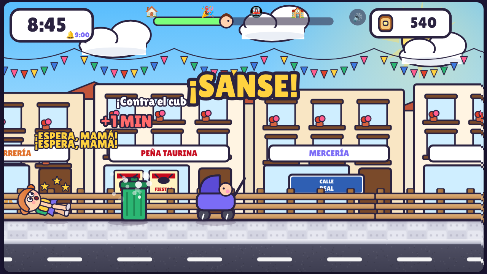 |
| Eliges quién lleva a los niños y entras a vestirlos | Frenazo, ojos en X 😵, un peque tropieza y el reloj suma un minuto |

<a id="peques"></a>

## 👕 Los peques

| Escritorio | Móvil |
| :---: | :---: |
| 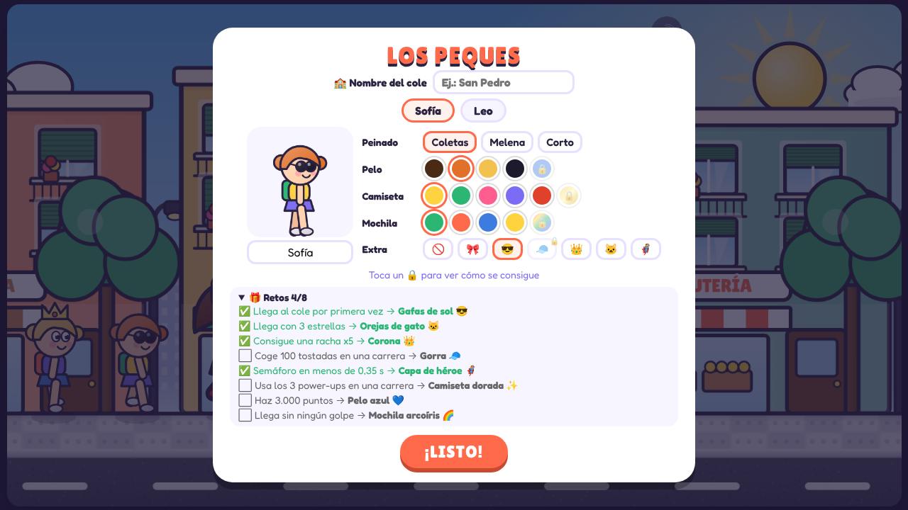 | 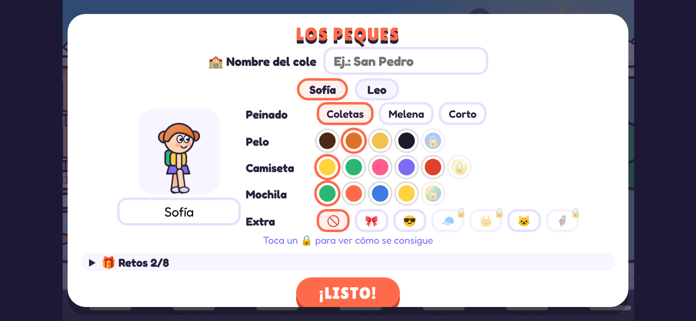 |

En **👕 Peques** pones el **nombre de tu cole** (sale en el cartel de la entrada y al llegar) y cada niño tiene su **nombre**, **peinado** (coletas, melena o corto), **color de pelo**, **camiseta**, **mochila** y un **extra**. Lo que tiene un 🔒 se desbloquea con los retos; si lo tocas, te dice cómo conseguirlo.

### 🎁 Retos

| Reto | Premio |
| --- | --- |
| Llega al cole por primera vez | 😎 Gafas de sol |
| Llega con 3 estrellas | 🐱 Orejas de gato |
| Consigue una racha x5 | 👑 Corona |
| Coge 100 tostadas en una carrera | 🧢 Gorra |
| Semáforo en menos de 0,35 s | 🦸 Capa de héroe |
| Usa los 3 power-ups en una carrera | ✨ Camiseta dorada |
| Haz 3.000 puntos | 💙 Pelo azul |
| Llega sin ningún golpe | 🌈 Mochila arcoíris |

<p align="center">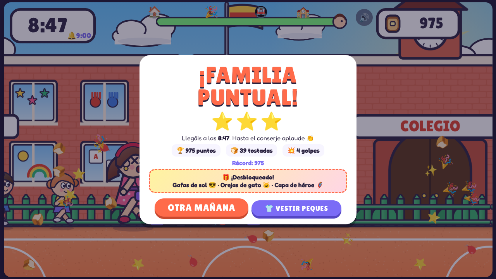</p>

<a id="movil"></a>

## 📱 En el móvil

<table>
<tr>
<td width="28%" align="center" valign="top">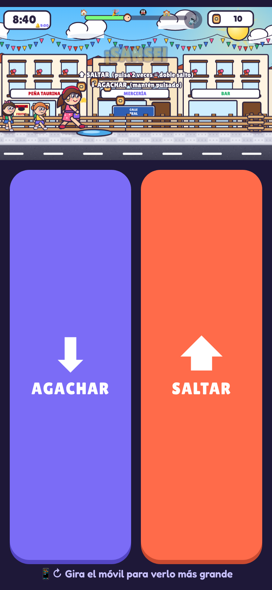<br><sub><b>En vertical:</b> botones enormes</sub></td>
<td width="72%" align="center" valign="top">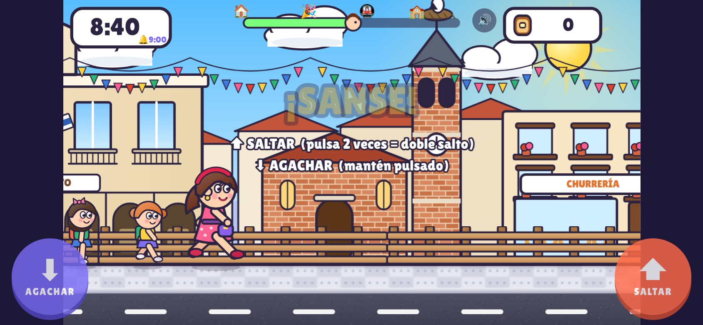<br><sub><b>En horizontal:</b> pantalla completa con los botones a mano</sub><br><br>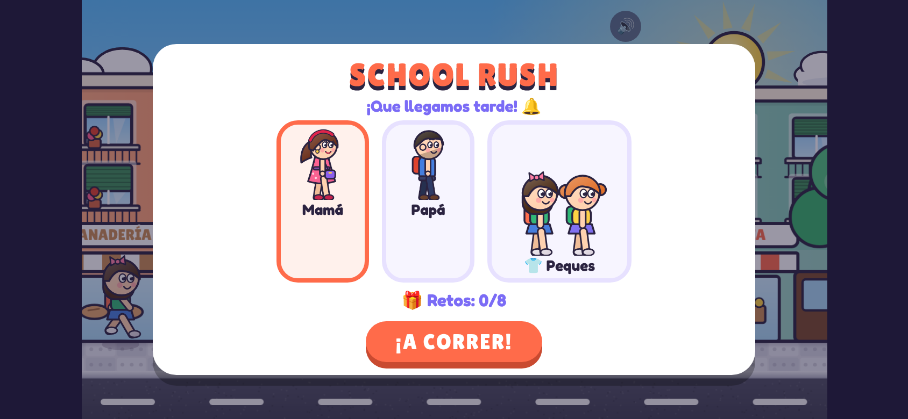<br><sub><b>Menú</b></sub></td>
</tr>
</table>

Pensado para jugar con el dedo:

| | |
| --- | --- |
| 🔄 **En horizontal** | El juego ocupa toda la pantalla y los botones **⬇ AGACHAR** y **⬆ SALTAR** flotan en las esquinas, a mano de los pulgares |
| 📱 **En vertical** | El juego arriba y dos **botones enormes** debajo: ideal para los más pequeños |
| ⛶ **Pantalla completa** | En Android se pone a pantalla completa y en horizontal al empezar |
| 📳 **Vibración** | El móvil vibra en cada golpe (Android) |
| 📦 **Como una app** | Se instala en la pantalla de inicio con su icono y **funciona sin internet** |

> Todas las imágenes de este README las saca un robot que juega partidas de verdad (ver [Capturas automáticas](#capturas)).

## ✨ Características

- 🎨 **Dibujos animados hechos con código**: personajes que parpadean, se estiran al saltar, se aplastan al caer y dan una voltereta en el doble salto.
- 🏙️ **Fondos ilustrados por capas** con efecto de profundidad (*parallax*).
- 💥 **Golpes que se notan**: frenazo, tambaleo, ojos en X y cámara temblando.
- 💬 **Frases de mañana con prisas**: *¡Que llegamos tarde!*, *¿Y los zapatos?*, *¡Mis llaves!*
- 🎵 **Música y efectos** generados en directo, sin archivos de audio. Botón 🔇 para silenciar.
- 🏆 **Récord de puntos** guardado en el móvil.
- 🔒 **Sin anuncios, sin cuentas y sin recoger datos.**

<a id="privacidad"></a>

## 🔒 Privacidad

El juego no trata datos personales fuera del propio dispositivo.

| | |
| --- | --- |
| **Qué se guarda** | Quién lleva a los niños, el nombre del cole, nombre y aspecto de cada peque, retos conseguidos, récord de puntos, si ya viste el tutorial y si el sonido está silenciado |
| **Dónde** | Solo en el `localStorage` del navegador de ese móvil o tablet. Nada se envía a ningún servidor |
| **Qué no hace** | Sin cookies, sin analítica, sin publicidad y sin rastreadores |
| **Fuentes** | Las letras van dentro de la propia web (`fonts/`): el juego no hace peticiones a Google |
| **Borrar** | Borra los datos del sitio en el navegador |

## 📲 Abrirlo como una app

| Android (Chrome) | iPhone / iPad (Safari) |
| --- | --- |
| Abre [serbenda.github.io/school-rush](https://serbenda.github.io/school-rush/) → menú **⋮** → **Instalar aplicación** | Abre [serbenda.github.io/school-rush](https://serbenda.github.io/school-rush/) → **Compartir** → **Añadir a pantalla de inicio** |

Se abre a pantalla completa, con su icono, y **después de abrirlo una vez con conexión ya funciona sin internet**.

<a id="tecnica"></a>

## 🛠️ Bajo el capó

HTML, CSS y JavaScript a pelo, en **un único `index.html` sin dependencias ni paso de compilación**, dibujando sobre un `<canvas>` de 960 × 540 que se escala a la pantalla.

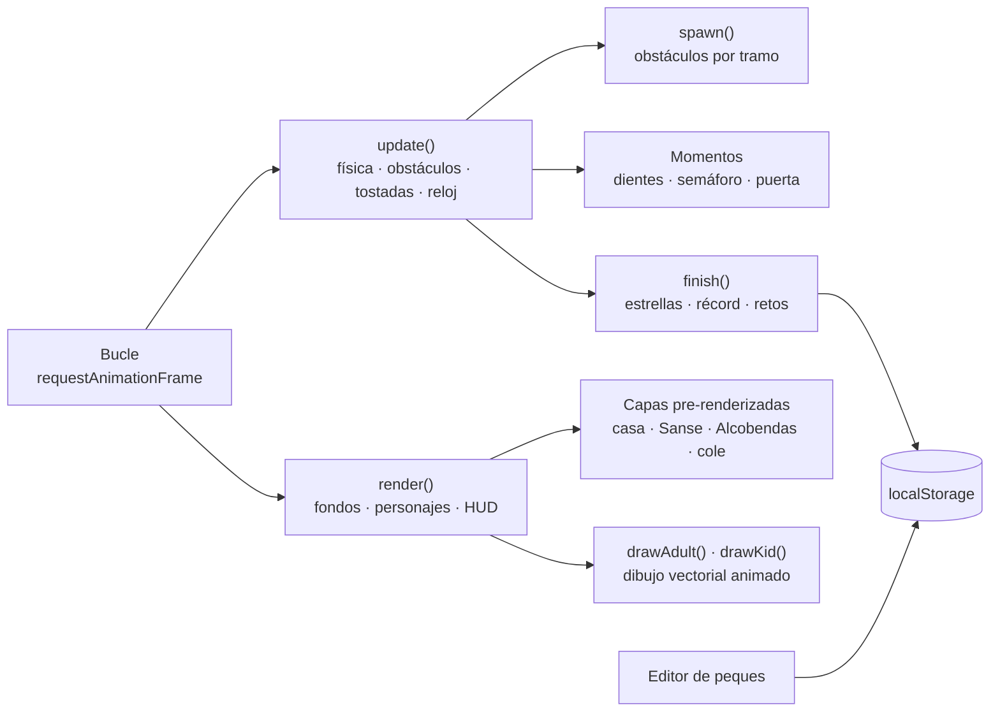

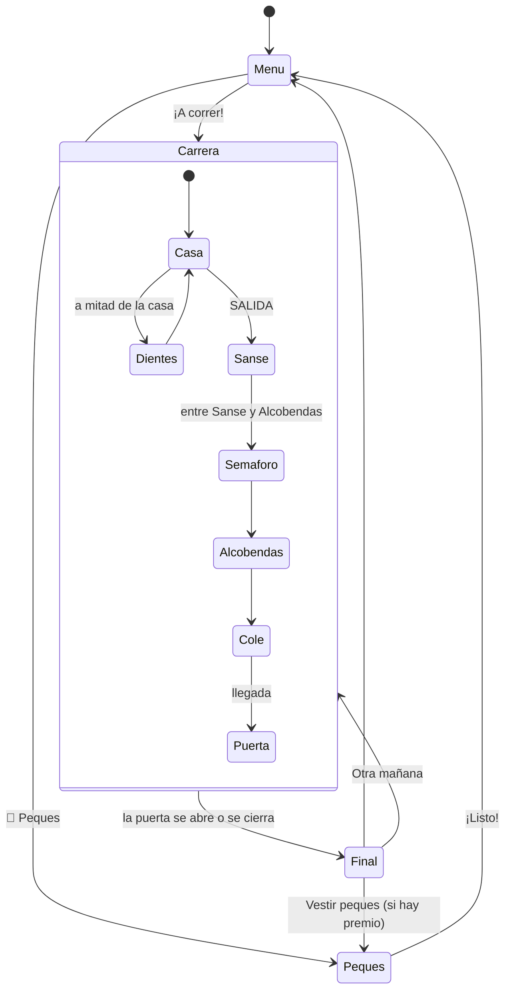

| Pieza | Cómo funciona |
| --- | --- |
| **Mundo** | Una carrera de 30.000 unidades: casa hasta 9.000, Sanse hasta 17.100, Alcobendas hasta 24.000 y cole hasta el final. La velocidad sube de 330 a 500 por segundo |
| **Reloj** | Empieza a las 8:40 y avanza un minuto cada 5,5 s. Los golpes y los fallos en los momentos suman minutos |
| **Física** | Gravedad, salto y doble salto con *buffer* de pulsación; agacharse en el aire te hace caer rápido; el paraguas reduce la gravedad |
| **Obstáculos** | Se generan por delante según el tramo, con separación según la velocidad. Cada uno sabe si es *bajo* (saltar) o *alto* (agacharse) |
| **Golpes** | Congelan el juego 0,13 s, tumban a un peque y frenan la carrera hasta que te alcanza |
| **Personajes** | Dibujados con trazos vectoriales en cada fotograma: piernas y brazos con ciclo de carrera, estirar y aplastar, parpadeo, sombreado y sombras |
| **Fondos** | Cada tramo se pinta **una sola vez** en capas grandes que luego solo se recortan y desplazan a distinta velocidad, para ir fluido en el móvil |
| **Tutorial** | La primera partida pone dos obstáculos fijos y ralentiza el tiempo hasta que haces el gesto correcto |
| **Sonido** | Música y efectos sintetizados con Web Audio: no hay archivos de audio |
| **Móvil** | En vertical el lienzo ocupa el ancho y los botones el resto; en horizontal, el lienzo ocupa la pantalla y los botones flotan encima |
| **Sin internet** | Un *service worker* (`sw.js`) guarda el juego: primero intenta la red para tener la última versión y, si no hay conexión, usa lo guardado |

### 📁 Estructura

```
school-rush/
├── index.html                  # El juego entero: estilos, dibujo, lógica y menús
├── manifest.webmanifest        # Datos para instalarlo como app
├── sw.js                       # Service worker: juego sin internet
├── icons/                      # Iconos de la app
├── fonts/                      # Letras Fredoka y Lilita One (SIL OFL), servidas desde la propia web
├── scripts/
│   └── capturas.py             # Robot que juega y saca las imágenes del README
├── docs/img/                   # Imágenes del README (generadas por el robot)
├── .github/workflows/
│   └── pages.yml               # Publica el juego en GitHub Pages en cada cambio en main
├── README.md · README.en.md
└── LICENSE
```

### 💻 Probarlo en local

```bash
git clone https://github.com/serbenda/school-rush.git
cd school-rush
python3 -m http.server 8000   # para que carguen las fuentes
# abre http://localhost:8000
```

### 🌿 Ramas

| Rama | Para qué |
| --- | --- |
| `main` | Versión estable: es la que se publica en [serbenda.github.io/school-rush](https://serbenda.github.io/school-rush/) |
| `development` | Donde se prueban las novedades antes de pasar a `main` con un *pull request* |

> Si cambias el juego, sube la versión en `sw.js` (`school-rush-v1` → `school-rush-v2`) para que los móviles con la app instalada se actualicen.

<a id="capturas"></a>

### 🤖 Capturas automáticas

`scripts/capturas.py` abre el juego en un Chromium real con **Playwright**, juega una partida con un pequeño robot (salta lo bajo y se agacha con lo alto), va a cada tramo y momento, saca las capturas en escritorio y móvil y monta el GIF con **ffmpeg** en `docs/img/`.

```bash
pip install playwright && playwright install chromium
python3 scripts/capturas.py
```

<a id="ruta"></a>

## 🗺️ Hoja de ruta

- [x] Carrera continua casa → calle → cole
- [x] Mamá o papá, con los peques detrás
- [x] Saltar, doble salto y agacharse
- [x] Momentos: dientes, semáforo y puerta del cole
- [x] Tostadas, rachas y power-ups
- [x] Tutorial jugable la primera vez
- [x] Personalizar a los peques y 8 retos con premios
- [x] Fondos ilustrados por capas y personajes con sombreado
- [x] Fuentes dentro de la web, sin peticiones a Google
- [x] Calles de Sanse y Alcobendas, con el toro de los encierros
- [x] Nombre del cole editable
- [x] Botones táctiles, modo vertical y pantalla completa en el móvil
- [x] App instalable que funciona sin internet
- [ ] Mañanas distintas: lunes, viernes con lluvia, día de excursión
- [ ] Eventos sorpresa: *¡Se ha dejado el almuerzo!*
- [ ] Música distinta en cada tramo
- [ ] El juego también en inglés (el README ya lo está)

## ⚖️ Licencia

© 2026 Santiago. **Todos los derechos reservados.** Puedes jugar y ver el código, pero no copiarlo, modificarlo ni redistribuirlo sin permiso. Ver [LICENSE](LICENSE).

Idea, diseño y pruebas: **Santiago** (y sus probadoras oficiales 👧).

Fuentes: *Fredoka* y *Lilita One*, de Google Fonts, con licencia SIL Open Font License (incluidas en `fonts/`).

<div align="center">
<br>
<sub>Hecho con ☕ prisas, 🍞 tostadas y muchas mañanas de <i>¡que llegamos tarde!</i></sub>
</div>
